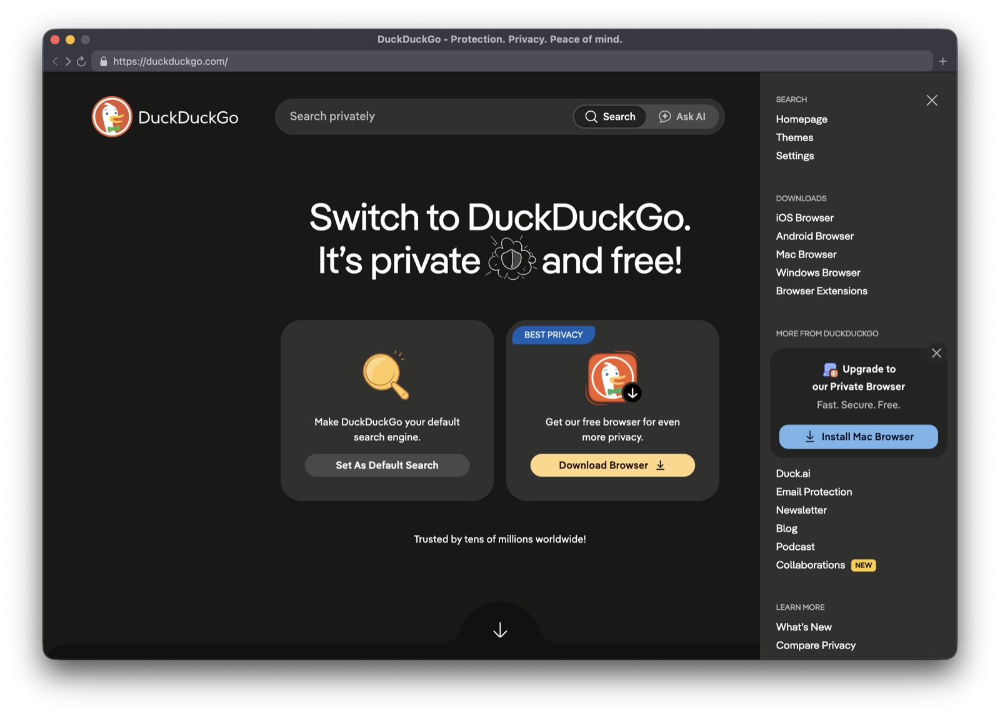

# CefSwift

CefSwift embeds Chromium in any macOS app written in Swift, through the
[Chromium Embedded Framework](https://github.com/chromiumembedded/cef) (CEF).
It exposes what CEF and Chromium can do as Swift types: browsers in SwiftUI
and AppKit views, windowed or offscreen; Chrome-style windows with Chrome's
own pages and settings; profiles, requests, DevTools, custom
schemes and a JavaScript bridge. Optional libraries add passkeys the app
answers and Chromium's bookmark, history and suggestion stores. That is
enough for a full web browser; the Browser example below is one.



CefSwift is pre-1.0; its API can change between releases.

## Getting started

An app that embeds Chromium is an app bundle with Chromium's framework and
five helper apps inside. Build it with SwiftPM or with Xcode: both run the
same `cefswift` tool to put the framework and helpers in, sign them and
check the result, so the bundles are the same. [Bundling](docs/bundling.md)
covers each track in depth.

### With SwiftPM

1. Depend on CefSwift:

   ```swift
   // swift-tools-version: 6.0
   // Package.swift
   import PackageDescription

   let package = Package(
       name: "MyApp",
       platforms: [.macOS(.v14)],
       dependencies: [
           .package(url: "https://github.com/Rajaniraiyn/CefSwift", branch: "main"),
       ],
       targets: [
           .executableTarget(name: "MyApp", dependencies: [
               .product(name: "CefSwiftUI", package: "CefSwift"),
           ]),
       ]
   )
   ```

2. Write the app ([below](#show-a-web-page)) in `Sources/MyApp/MyApp.swift`.
3. Bundle and run it with the package's `cef` command plugin:

   ```sh
   swift package --allow-writing-to-package-directory --allow-network-connections all \
       cef bundle --product MyApp
   open dist/MyApp.app
   ```

The first run downloads the pinned CEF build (about 135 MB) into `.cef/`;
add `.cef/` and `dist/` to `.gitignore`. `swift run` cannot start Chromium,
which runs only from the bundle. Settings go in a `cefapp.json` beside the
sources.

### With Xcode

1. In an app project (File › New › Project › macOS › App, SwiftUI), add the
   package: File › Add Package Dependencies…, enter
   `https://github.com/Rajaniraiyn/CefSwift`, and add `CefSwiftUI` to the
   app target.
2. In the target's Signing & Capabilities, remove App Sandbox: it is not
   supported with official CEF builds ([why](docs/bundling.md#app-sandbox)).
3. Copy [`Examples/Xcode/CefSwift.xcconfig`](Examples/Xcode/CefSwift.xcconfig)
   into the project and choose it as the target's configuration file
   (Project › Info › Configurations). For a local package, set its
   `CEFSWIFT_PACKAGE_DIR` to the package's path.
4. In Build Phases, add a Run Script phase at the end, turn off "Based on
   dependency analysis", and run:

   ```sh
   "$CEFSWIFT_PACKAGE_DIR/Scripts/xcode-embed.sh"
   ```

5. Write the app ([below](#show-a-web-page)), then Run.

The first build downloads CEF into `.cef/` beside the project. Settings are
build settings: Xcode's own, and `CEF_…` ones for what only CefSwift has.
[`Examples/Xcode`](Examples/Xcode) is a project set up this way.

### Show a web page

```swift
import CefSwiftUI
import SwiftUI

@main
struct MyApp: CefSwiftApp {
    var body: some Scene {
        WindowGroup {
            CefWebView(url: URL(string: "https://example.com")!)
        }
    }
}
```

`CefSwiftApp` takes the place of `App`: it starts Chromium before SwiftUI
runs. In Xcode's SwiftUI previews, which cannot start Chromium, a
`CefWebView` shows a placeholder.

`CefSwiftUI` re-exports `CefKit`, the core library. An AppKit app depends on
`CefKit` alone: its `CefWindowedBrowserView` and `CefOffscreenBrowserView`
host a browser without SwiftUI (see [In AppKit](docs/guide.md#in-appkit)).
Optional features are libraries of their own on top of `CefKit`: add
`CefPasskeys` for passkeys the app answers, and `CefChromium` for Chromium's
own browser features: its bookmarks, history and address-bar suggestions,
its extensions, and its bubbles, find bar and status bubble in Chrome-style windows, anchored,
replaced with your own interface or hidden. `CefChromium` is bound to
Chromium-private interfaces of the pinned CEF, so it is the part most likely
to need attention when CEF updates.

### Use Chrome-style windows

Chromium shows Chrome's own pages and UI only in windows it creates. A
`CefWindow` is one, holding one browser; macOS can group several under a
native tab bar. The toolbar is SwiftUI. This app uses
`defaultLaunchBehavior(_:)`, so set `platforms: [.macOS(.v15)]`.

```swift
import AppKit
import CefSwiftUI
import SwiftUI

@main
struct MyBrowser: CefSwiftApp {
    static var runtimeConfiguration: CefRuntime.Configuration { .chrome }
    @NSApplicationDelegateAdaptor private var appDelegate: AppDelegate

    var body: some Scene {
        // `CefWindow`s are not SwiftUI scenes. Settings is the only
        // scene, so keep SwiftUI from opening it at launch.
        Settings { EmptyView() }
            .defaultLaunchBehavior(.suppressed)   // macOS 15
    }
}

@MainActor
final class AppDelegate: NSObject, NSApplicationDelegate {
    func applicationDidFinishLaunching(_ notification: Notification) {
        openTab()
    }

    /// Called by the "+" button in the native tab bar.
    @objc func newWindowForTab(_ sender: Any?) {
        openTab()
    }

    func openTab() {
        let browser = CefBrowser(url: URL(string: "https://www.swift.org")!)
        var configuration = CefWindow.Configuration()
        configuration.tabbingIdentifier = "tabs"
        let window = CefWindow(browser: browser, configuration: configuration)
        window.setToolbar {
            BackButton(browser: browser)
        } principal: {
            PageTitle(browser: browser)
        } trailing: {
            Button("New Tab", systemImage: "plus") { self.openTab() }
        }
        window.show()
    }
}

struct BackButton: View {
    let browser: CefBrowser
    var body: some View {
        Button("Back", systemImage: "chevron.left", action: browser.goBack)
            .disabled(!browser.canGoBack)
    }
}

struct PageTitle: View {
    let browser: CefBrowser
    var body: some View { Text(browser.title).lineLimit(1) }
}
```

The toolbar views are separate `View` types so that they read the
browser's state in their `body` and update when it changes.

## Two starting points

| | Your own or trusted content | Arbitrary sites, with Chrome's services |
|---|---|---|
| Configuration | `CefRuntime.Configuration.embedded` | `CefRuntime.Configuration.chrome` |
| Host | `CefWebView` in your own windows (Alloy style) | `CefWindow` (Chrome style, one tab), `CefChromeWindow` (Chromium's tabbed windows, with your own tab interface over Chrome's), or `CefRuntime.shared.openChromeWindow(url:)` for Chrome's complete UI |
| Chrome runtime (`chrome://` pages, extensions, history) | No | Yes |
| Background services | Off | On |

## Where things live

| Where | What | Examples |
|---|---|---|
| `CefKit` (core) | What any app embedding CEF needs and could not write itself: the runtime, browsers, profiles, the AppKit host views, CEF Views windows (`CefWindow`), handlers and delegates, offscreen rendering and its accessibility, discarding | `CefRuntime`, `CefBrowser`, `CefProfile`, `CefOffscreenBrowserView`, `CefWindow` |
| `CefSwiftUI` | SwiftUI on top of `CefKit`, nothing else | `CefSwiftApp`, `CefWebView`, `setToolbar`, `setPageOverlay` |
| `CefPasskeys`, `CefChromium` (optional) | Capabilities on Chromium internals some apps want: passkeys the app answers; Chromium's bookmark, history and suggestion stores, its extensions, its tab strip and its bubbles | `CefPasskeyController`, `CefBookmarks`, `CefChromeWindow`, `CefTabStrip`, `CefChromiumSurface` |
| `Examples` | Product decisions written against the public API: UI, defaults, heuristics for when to use a capability | the Browser's toolbar, swipe indicator, Memory Saver, permission names |

The rule: the library holds what an app cannot write against its public
API, because it calls the CEF C API, hooks Chromium or works around a CEF
or Chromium limit, plus the defaults an embedder cannot ship without: the
built-in sheets and presenters that answer a delegate method nobody
implemented, each replaceable. Everything else belongs to the app.

## Features

| Feature | API | Guide |
|---|---|---|
| Observable browser model | `CefBrowser` | [Browsers](docs/guide.md#browsers) |
| Waiting for a navigation to load, with its outcome | `load(_:)` → `CefNavigation`, `waitUntilLoaded(timeout:)` | [Waiting for a load](docs/guide.md#waiting-for-a-load) |
| SwiftUI and AppKit views, windowed or offscreen | `CefWebView`, `CefWindowedBrowserView`, `CefOffscreenBrowserView` | [Showing a browser](docs/guide.md#showing-a-browser) |
| Pages under SwiftUI and AppKit animations and transforms, with input that follows; live thumbnails laid out at their own size | `offscreenResizePolicy(_:)`, `offscreenPageSize(_:)`, `offscreenFramePlacement(_:)` | [Animating a page](docs/guide.md#animating-a-page) |
| JavaScript evaluation with timeouts, user scripts and style sheets | `evaluateJavaScript(_:timeout:)`, `CefUserScript` | [JavaScript](docs/guide.md#javascript) |
| Typed calls between JavaScript and Swift | `CefBridge` | [Bridge](docs/guide.md#bridge) |
| Asynchronous decisions: permissions, dialogs, certificate errors | `CefBrowserDelegate` | [Decisions](docs/guide.md#decisions) |
| Policy for every page of a profile, Chromium's own included: request filter with declarative matching, scheme handlers, user scripts, bridges, attachments, permission and download decisions, Chromium settings and proxy | `CefProfile`, `CefProfileDelegate`, `CefRequestFilter`, `CefProfile.Configuration` | [What is configured where](docs/guide.md#what-is-configured-where) |
| Native default sheets, localizable and each replaceable | `CefDialogPresenter`, `CefDownloadPresenter`, … | [Built-in sheets](docs/guide.md#built-in-sheets) |
| Downloads: a profile policy and delegate, a save panel, observable downloads for a download manager | `CefProfile.downloadPolicy`, `CefProfileDelegate`, `CefProfile.downloads`, `CefDownload` | [Downloads](docs/guide.md#downloads) |
| The back/forward list, and going to any entry in one navigation | `backForwardList`, `go(to:)` | [Back and forward](docs/guide.md#back-and-forward) |
| Links to other apps (`mailto:`, `zoommtg:`), decided by the app | `browser(_:decideExternalProtocolFor:)`, `CefExternalProtocolPresenter` | [Links to other apps](docs/guide.md#links-to-other-apps) |
| Page tooltips, observable and replaceable | `tooltip`, `tooltipPolicy` | [Tooltips](docs/guide.md#tooltips) |
| Context menu | `CefBrowser.Configuration.ContextMenu` | [Context menu](docs/guide.md#context-menu) |
| Chrome-style windows (CEF Views), SwiftUI toolbars, a view over the page, popups, native tabs | `CefWindow`, `pageOverlay` | [Chrome-style windows](docs/guide.md#chrome-style-windows) |
| Chrome commands and Chrome UI trimming | `CefChromeCommand`, `CefRuntime.Configuration.ChromeToolbar` | [Chrome commands](docs/guide.md#chrome-commands) |
| Rebranded and restyled `chrome://` pages | `productName`, `stringOverrides`, `CefUserScript.styleSheet(_:matching:includingShadowRoots:)` | [Chromium's own pages](docs/guide.md#customizing-chromiums-own-pages) |
| Profiles, typed cookies, Chromium preferences, per-profile casting | `CefProfile`, `CefProfile.Cookie`, `mediaRouter` | [Profiles](docs/guide.md#profiles) |
| The app's own requests through Chromium's network stack, sharing a profile's cookies, cache and proxy | `CefProfile.data(for:)`, `bytes(for:)` | [Requests through Chromium's network stack](docs/guide.md#requests-through-chromiums-network-stack) |
| Chromium's bookmarks, history and omnibox suggestions (the optional `CefChromium` library) | `CefBookmarks`, `CefHistory`, `CefAutocomplete` | [Bookmarks, history and suggestions](docs/guide.md#bookmarks-history-and-suggestions) |
| Chromium's own tabs, windows and tab groups, mirrored and driven, with your own tab interface over Chrome's (`CefChromium`) | `CefChromeWindow`, `CefTab`, `CefTabGroup`, `CefTabStrip` | [Chromium's tab strip](docs/guide.md#chromiums-tabs-windows-tabs-and-groups) |
| Chrome extensions: the Chrome Web Store, a profile's extensions (the optional `CefChromium` library), extensions the app installs by store identifier or ships in its bundle | `CefExtensions`, `CefRuntime.Configuration.extensions` | [Extensions](docs/guide.md#extensions) |
| Discarding hidden browsers to free memory, and restoring them when shown (when to discard is the app's choice) | `discard()`, `discardBlockers()`, `lifecycle`, `lifecycleChangedAt` | [Discarding browsers](docs/guide.md#discarding-browsers) |
| Chrome DevTools Protocol, in-process | `CefDevTools` | [DevTools](docs/guide.md#devtools) |
| Your own set-up code for every browser of a configuration, before its first page if it must | `CefBrowserAttachment` | [Attachments](docs/guide.md#attachments) |
| Passkeys answered by the app from its own store, or refused (the optional `CefPasskeys` library) | `CefPasskeyController`, `CefPasskeyStore` | [Passkeys](docs/guide.md#passkeys) |
| Content served from your own URL scheme | `CefSchemeHandler` | [Serving your own content](docs/guide.md#serving-your-own-content) |
| Protected media: Widevine in Chromium; the Browser example shows FairPlay services in the system's WebKit beside it | `CefRuntime.Configuration.services.protectedMedia` | [Playing streaming services](docs/guide.md#playing-streaming-services) |

## Examples

[`Examples/`](Examples/README.md) is a separate package with five apps:

- **Browser**: a tabbed browser built on the public API: a SwiftUI
  toolbar, address-bar suggestions, bookmarks, history, private tabs,
  downloads, popups, a swipe indicator, and a Memory Saver that puts
  background tabs to sleep.
- **Gallery**: a library of small examples, one capability each, from a
  web view bound to a browser's state to passkeys answered by the app.
- **Minimal**: one `CefWebView` on the `.embedded` configuration, and the
  lean case of the footprint benchmark.
- **Compat**: one page in one kind of host with chosen CefSwift features,
  for the web-compatibility matrix (`Scripts/compat-matrix.py`).
- **SelfTest**: end-to-end checks against the real Chromium runtime, run by CI.

[`Examples/Xcode`](Examples/README.md#xcode) is an Xcode project instead:
one `CefWebView`, built by Xcode with CefSwift's build phase.

## Requirements

- macOS 14 or later (the examples need macOS 15), Apple silicon or Intel.
- Swift 6 toolchain. The Command Line Tools are enough for SwiftPM; an
  Xcode project needs Xcode 16 or later.

The CEF version is pinned in `CEF_VERSION.json` and updated by
[automation](docs/automation.md).

## Documentation

- [Guide](docs/guide.md): how to do each task.
- [Architecture](docs/architecture.md): how CefSwift works inside.
- [Bundling](docs/bundling.md): the app bundle, signing, capabilities and distribution.
- [Sandbox](docs/sandbox.md): Chromium's macOS sandbox.
- [Automation](docs/automation.md): CEF updates, CI and releases.
- [Contributing](CONTRIBUTING.md): building, testing and regenerating the C bridge.

## License

BSD 3-Clause, the same as CEF. See [LICENSE](LICENSE).
