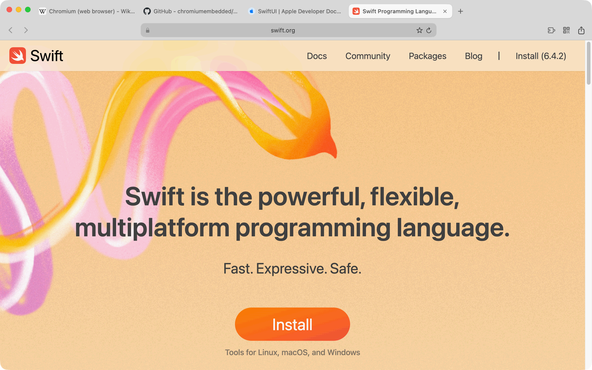

# CefSwift

Build your own Chromium browser for the Mac in Swift. No Chromium checkout,
no fork to rebase, no Electron.

[](CEF_VERSION.json)
[](https://swift.org)
[](#requirements)
[](#quick-start)
[](LICENSE)

CefSwift is a Swift and SwiftUI binding for the official prebuilt
[Chromium Embedded Framework](https://github.com/chromiumembedded/cef)
(CEF). Chromium's tabs, profiles, extensions, bookmarks, history and
address-bar suggestions are Swift types; your app draws the interface.

<!-- Demo video or GIF of the Browser example goes here. -->


## Build a browser

Chromium's own tabbed window, with Chrome's tab strip covered by a SwiftUI
one. The tabs are Chromium's, so ⌘T, ⌘⇧T, extensions and dragging a tab
out work as in Chrome:

```swift
import CefChromium
import CefSwiftUI
import SwiftUI

@main
struct MyBrowser: CefSwiftApp {
    static var runtimeConfiguration: CefRuntime.Configuration { .chrome }
    @NSApplicationDelegateAdaptor private var delegate: Launcher
    var body: some Scene { Settings { EmptyView() }.defaultLaunchBehavior(.suppressed) }  // macOS 15
}

@MainActor final class Launcher: NSObject, NSApplicationDelegate {
    func applicationDidFinishLaunching(_ notification: Notification) {
        CefProfile.default.tabs.onWindowOpened = { window in
            window.showsChromeUI = false
            window.setTopBar { TabRail(window: window) }
        }
        Task { try await CefChromeWindow.open(url: URL(string: "https://swift.org")!) }
    }
}

struct TabRail: View {
    let window: CefChromeWindow
    var body: some View {
        HStack {
            ForEach(window.tabs) { tab in
                Button(tab.title) { Task { try await tab.select() } }.bold(tab.isActive)
            }
        }
        .padding(.leading, 80)
    }
}
```

Embedding a page in your own app is one view:

```swift
CefWebView(url: URL(string: "https://example.com")!)
```

## What you get

| Browser | Embedding |
|---|---|
| [Chromium's tabs and groups](https://rajaniraiyn.dev/cefswift/browser/tabs) under your own tab strip, across or down the side | [`CefWebView`](https://rajaniraiyn.dev/cefswift/embed/webview) in SwiftUI, windowed or [offscreen](https://rajaniraiyn.dev/cefswift/embed/offscreen), and AppKit host views |
| [Address-bar suggestions](https://rajaniraiyn.dev/cefswift/browser/address-bar) ranked by Chromium | An observable `CefPage`: title, URL, loading, history, favicon, downloads |
| [Bookmarks and history](https://rajaniraiyn.dev/cefswift/browser/bookmarks-history) from Chromium's own stores | A typed [JavaScript bridge](https://rajaniraiyn.dev/cefswift/embed/javascript), user scripts, `evaluateJavaScript` |
| [Chrome extensions](https://rajaniraiyn.dev/cefswift/browser/extensions) and the Web Store | [Custom schemes](https://rajaniraiyn.dev/cefswift/embed/custom-schemes) serving your app's content |
| [Downloads](https://rajaniraiyn.dev/cefswift/browser/downloads), [find bar and Chromium's bubbles](https://rajaniraiyn.dev/cefswift/browser/find-bar) replaced with SwiftUI | [Request filtering](https://rajaniraiyn.dev/cefswift/embed/request-filtering) on Chromium's IO thread, requests through its network stack |
| [Permission prompts, popups, sign-in sheets](https://rajaniraiyn.dev/cefswift/browser/popups-and-permissions) of your own | [DevTools and the DevTools Protocol](https://rajaniraiyn.dev/cefswift/embed/devtools-and-automation), in process |
| [Profiles and private windows](https://rajaniraiyn.dev/cefswift/browser/profiles) | SwiftUI [animation](https://rajaniraiyn.dev/cefswift/embed/animation) and [swipe navigation](https://rajaniraiyn.dev/cefswift/embed/swipe-navigation) |
| [Passkeys](https://rajaniraiyn.dev/cefswift/browser/passkeys) from Chromium or your own store | [Accessibility](https://rajaniraiyn.dev/cefswift/embed/accessibility) for offscreen pages |
| [Tab discarding and session restore](https://rajaniraiyn.dev/cefswift/browser/discarding-and-sessions) | Chromium's [process and sandbox](https://rajaniraiyn.dev/cefswift/internals/sandboxing) model, kept on |
| [Renamed and restyled `chrome://` pages](https://rajaniraiyn.dev/cefswift/browser/chrome-pages) | Bundling, signing and notarization [with SwiftPM or Xcode](https://rajaniraiyn.dev/cefswift/ship/tracks) |

## Why not fork Chromium, Electron or WKWebView

| | CefSwift | A Chromium fork | Electron | `WKWebView` |
|---|---|---|---|---|
| Engine | Chromium, from the official prebuilt CEF | Chromium | Chromium | WebKit |
| Interface in | Swift, SwiftUI, AppKit | C++ and Chromium's views | HTML, CSS, JavaScript | Swift, SwiftUI, AppKit |
| Build | `swift package cef bundle`, minutes | A Chromium checkout and hours per build | npm | Xcode |
| Chromium updates | Bump `CEF_VERSION.json` (automated pull requests) | Rebase the fork every release | Electron releases | – |
| Chrome extensions, `chrome://` pages | Yes | Yes | Partial, through Electron's API | No |
| Chromium's tabs, bookmarks, history, suggestions | Yes, as Swift types | Yes | No | No |
| H.264 and AAC | No; show those sites in a `WKWebView` | If built with proprietary codecs | Yes | Yes |
| DRM | Widevine L3 (software) | Widevine, with Google's agreement | Widevine through castLabs' Electron build | FairPlay |
| Mac App Store | No (no App Sandbox with official CEF) | No | Yes | Yes |

## Numbers

Measured on an Apple M3 MacBook, macOS 27.2.1, with
[`Scripts/measure-footprint.py`](Scripts/measure-footprint.py) and SelfTest's
benchmarks ([footprint](docs/guide.md#footprint-and-launch-time),
[design notes](docs/design-notes.md)):

- **88 MB, 5 processes, 306 ms to a loaded page** for one `CefWebView`
  (the Minimal example); a `WKWebView` app is 60 MB and 284 ms.
- **166 MB, 7 processes** for the Browser example with one tab, against
  286 MB and 12 processes for Chrome 157 with one tab.
- **About 12 MB per process** saved by linking the framework at launch
  instead of `dlopen`: the Minimal example went from 185 MB to 88 MB.
- **2 to 3 ms** for Chromium's local address-bar suggestions, **0.8 ms**
  for a 20-entry history search, from Swift, on warm service hosts.
- **About 100 frames a second** for a 5120×3200 offscreen page with a
  small change per frame, copying only the damage, against about 80
  copying whole frames.

## Quick start

1. Depend on CefSwift in `Package.swift`:

   ```swift
   // swift-tools-version: 6.0
   import PackageDescription

   let package = Package(
       name: "MyApp",
       platforms: [.macOS(.v14)],
       dependencies: [
           .package(url: "https://github.com/Rajaniraiyn/CefSwift", .upToNextMinor(from: "0.2.0")),
       ],
       targets: [
           .executableTarget(name: "MyApp", dependencies: [
               .product(name: "CefSwiftUI", package: "CefSwift"),
           ]),
       ]
   )
   ```

2. Write the app in `Sources/MyApp/MyApp.swift`:

   ```swift
   import CefSwiftUI
   import SwiftUI

   @main
   struct MyApp: CefSwiftApp {
       var body: some Scene {
           WindowGroup {
               CefWebView(url: URL(string: "https://example.com")!)
           }
       }
   }
   ```

   `CefSwiftApp` takes the place of `App`: it starts Chromium before
   SwiftUI runs.

3. Bundle and open it with the package's `cef` command plugin:

   ```sh
   swift package --allow-writing-to-package-directory --allow-network-connections all \
       cef bundle --product MyApp
   open dist/MyApp.app
   ```

The first run downloads the pinned CEF build (about 135 MB) into `.cef/`.
Add `.cef/` and `dist/` to `.gitignore`. `swift run` cannot start
Chromium, which runs only from the bundle. Settings go in a `cefapp.json`
beside the sources ([Per-product settings](docs/bundling.md#per-product-settings)).
For a tabbed browser, follow
[Your first browser in 10 minutes](https://rajaniraiyn.dev/cefswift/start/first-browser).

<details>
<summary>With Xcode</summary>

1. In an app project (File › New › Project › macOS › App, SwiftUI), add the
   package: File › Add Package Dependencies…, enter
   `https://github.com/Rajaniraiyn/CefSwift`, and add `CefSwiftUI` to the
   app target.
2. In the target's Signing & Capabilities, remove App Sandbox. Official CEF
   builds do not run under it, and the build phase stops with an error if
   it is on ([why](docs/bundling.md#app-sandbox)).
3. Copy [`Examples/Xcode/CefSwift.xcconfig`](Examples/Xcode/CefSwift.xcconfig)
   into the project and choose it as the target's configuration file
   (Project › Info › Configurations). For a local package, set its
   `CEFSWIFT_PACKAGE_DIR` to the package's path.
4. In Build Phases, add a Run Script phase at the end, turn off "Based on
   dependency analysis", and run:

   ```sh
   "$CEFSWIFT_PACKAGE_DIR/Scripts/xcode-embed.sh"
   ```

5. Write the app as above, then Run.

The first build downloads CEF into `.cef/` beside the project. Settings are
build settings: Xcode's own, and `CEF_…` ones for what only CefSwift has.
[`Examples/Xcode`](Examples/Xcode) is a project set up this way. In Xcode's
SwiftUI previews, which cannot start Chromium, a `CefWebView` shows a
placeholder.

</details>

## Use it with an agent

```sh
npx skills add Rajaniraiyn/CefSwift
```

installs two skills for Claude Code, Codex, Cursor and the other agents
[skills.sh](https://skills.sh) supports: `cefswift` (modules, hosts, the
rules that keep a CEF app running, an API cheat sheet) and
`build-a-browser` (a working starter, the API behind each browser feature,
recipes for vertical tabs, spaces and a command bar). The docs site
publishes [`llms.txt`](https://rajaniraiyn.dev/cefswift/llms.txt), and
[`AGENTS.md`](AGENTS.md) covers working on CefSwift itself.
[Build with an agent](https://rajaniraiyn.dev/cefswift/start/agents) has a
one-prompt browser to start from.

## Examples

[`Examples/`](Examples/README.md) is a separate package. It needs macOS 15.
Bundle and run an example from the repository root:

```sh
swift package --package-path Examples \
    --allow-writing-to-package-directory --allow-network-connections all \
    cef bundle --product Gallery
open Examples/dist/Gallery.app
```

| Example | What it is |
|---|---|
| `Browser` | A tabbed browser: a small core and a folder per feature, with a SwiftUI tab rail and toolbar over Chromium's own tab model |
| `Gallery` | 30 small demos, one capability each, in one SwiftUI app with a sidebar to pick them |
| `Minimal` | One `CefWebView` on the `.embedded` configuration |
| `Compat` | One page in one kind of host, for the web-compatibility matrix (`Scripts/compat-matrix.py`) |
| `SelfTest` | End-to-end checks against the real Chromium runtime; CI runs it |
| `SystemEngine` | A library target, not an app: the Browser's WebKit tabs for FairPlay content |
| [`Examples/Xcode`](Examples/README.md#xcode) | An Xcode project with one `CefWebView`, built with CefSwift's build phase |

## Built with CefSwift

- [CefSwift Browser](Examples/Sources/Browser): the example browser in this
  repository.

Built something with CefSwift? Open a pull request that adds it here and to
the [showcase](https://rajaniraiyn.dev/cefswift/reference/showcase).

## Modules

| Module | What it is | Needed |
|---|---|---|
| `CefKit` | The core: the runtime, pages, profiles, delegates, the AppKit host views (`CefWindowedPageView`, `CefOffscreenPageView`), CEF Views windows (`CefWindow`), offscreen rendering, discarding | Yes |
| `CefSwiftUI` | SwiftUI on top of CefKit: `CefSwiftApp`, `CefWebView`, toolbar and overlay modifiers. Re-exports CefKit | For SwiftUI apps |
| `CefChromium` | Chromium's own browser features: bookmarks, history, address-bar suggestions, extensions, Chromium's tabbed windows and tab strip (`CefChromeWindow`, `CefTabs`), and Chromium's bubbles, find bar and status bubble. Bound to Chromium-private interfaces of the pinned CEF | Optional |
| `CefPasskeys` | WebAuthn requests answered by the app from its own store, or refused | Optional |
| `cefswift` tool, `CefPlugin` (`swift package cef …`) | Download CEF, assemble, sign, check, package and notarize the `.app` (logic in `CefBundling`) | Build time |
| `CefHelper`, `CefRenderer`, `CefHelperStartup`, `CefBase`, `CCef` | The helper-process executable, its renderer-side code, the helper's sandbox startup library, shared reference counting and strings, and the CEF C headers and loader | Internal; built and bundled for you |

An app depends on `CefSwiftUI`, or on `CefKit` alone for AppKit, and adds
`CefChromium` or `CefPasskeys` if it needs them.
[Architecture](docs/architecture.md#modules) describes each module.

| | Your own or trusted content | Arbitrary sites, with Chrome's services |
|---|---|---|
| Configuration | `CefRuntime.Configuration.embedded` | `CefRuntime.Configuration.chrome` |
| Host | `CefWebView` or the AppKit host views, in your own windows (Alloy style) | `CefWindow` (a Chrome-style window of one tab); `CefChromeWindow` in CefChromium (Chromium's tabbed windows, with your own tab interface over Chrome's); `CefRuntime.shared.openChromeWindow(url:)` for Chrome's complete UI |
| `chrome://` pages, extensions, history | No | Yes |
| Background services | Off | On |

## Known limits

These come from CEF 158 and official CEF builds. The guide's
[Known limits](docs/guide.md#known-limits) lists the rest.

- No App Sandbox, so no Mac App Store: Chromium registers a Mach service
  the App Sandbox refuses. Bundling stops with an error if it is on.
  Chromium's own sandbox still confines the helpers ([Sandbox](docs/sandbox.md)).
- One Chrome-style browser view per window. A `CefWindow` holds one
  page, and Chromium counts it as a popup window of one tab. Only
  windows Chromium draws itself (`CefChromeWindow`, `openChromeWindow`)
  have real Chromium tabs.
- CEF restores no tabs or windows at startup. CefChromium can reopen the
  previous session when the app asks
  ([Restoring tabs and sessions](docs/guide.md#restoring-tabs-and-sessions)).
- CefSwift ships no Chrome extension. Users install extensions from the
  Chrome Web Store, and an app can install or bundle its own
  ([Extensions](docs/guide.md#extensions)).
- CefKit turns Chromium's `RemoteCoreAnimationAPI` feature off by default:
  with it on, pages Chromium draws itself do not reach the screen on
  macOS 27.2 ([why](docs/architecture.md#presenting-pages)).
- No H.264, HEVC or AAC, and Widevine only as a software (L3) client, so
  Netflix-class streaming services do not play in Chromium. They play
  through WebKit tabs (a `WKWebView`, which has FairPlay), as the Browser
  example's `WebKitTabs` feature does
  ([Playing streaming services](docs/guide.md#playing-streaming-services)).

## Requirements

- macOS 14 or later (the examples need macOS 15), Apple silicon or Intel.
  CI builds for macOS 14 and runs on macOS 15; it compiles for Intel but
  runs nothing there.
- A Swift 6 toolchain from Xcode 16 or later. `CefSwiftUI` uses SwiftUI's
  `@Entry` macro, whose plugin ships with Xcode: the Command Line Tools for
  macOS 27.2 build `CefKit` and `CefChromium` but not `CefSwiftUI`.

The CEF version is pinned in `CEF_VERSION.json` and updated by
[automation](docs/automation.md). CefSwift is pre-1.0 and its API can
change between minor releases, so depend on one minor version.

Upgrading an existing profile from CEF 156 to 158 can require signing in to
sites again. [Profile upgrade details](docs/guide.md#upgrading-profiles-from-cef-156)

## Documentation

The site, https://rajaniraiyn.dev/cefswift/, is built from these files:

- [Guide](docs/guide.md): how to do each task.
- [Architecture](docs/architecture.md): how CefSwift works inside.
- [Design notes](docs/design-notes.md): measurements behind design choices, and mechanisms measured and not used.
- [Bundling](docs/bundling.md): the app bundle, signing, capabilities and distribution.
- [Sandbox](docs/sandbox.md): Chromium's macOS sandbox.
- [Automation](docs/automation.md): CEF updates, CI and releases.
- [Contributing](CONTRIBUTING.md): building, testing and regenerating the C bridge.

## License

BSD 3-Clause, the same as CEF. See [LICENSE](LICENSE).
